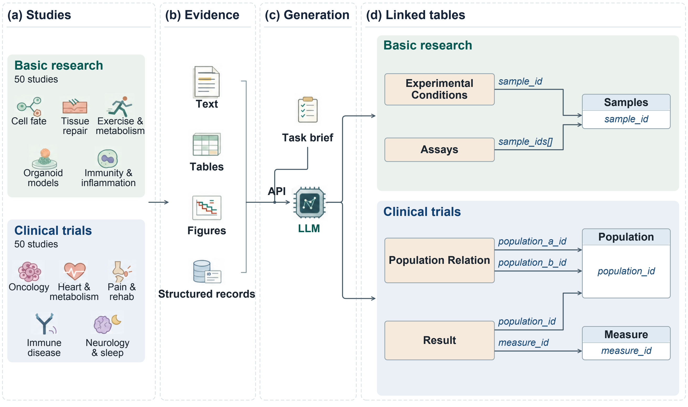

<h1 align="center">BioTraceBench</h1>

<p align="center"><strong>Can a model reconstruct a biomedical study as a linked database?</strong></p>

<p align="center">
  <a href="https://github.com/zoeyzheng0122/BioTraceBench/actions/workflows/ci.yml"></a>
  
  <a href="LICENSE"></a>
</p>

<p align="center">
  <a href="docs/DATASET.md">Dataset</a> ·
  <a href="reference/README.md">Reference Databases</a> ·
  <a href="docs/EVALUATION.md">Evaluation</a> ·
  <a href="docs/REPRODUCTION.md">Reproduce</a> ·
  <a href="CITATION.cff">Citation</a>
</p>

BioTraceBench evaluates whether a generated database preserves the experimental objects, measurements, and relationships described in a biomedical study.

## At a Glance

| Item | Value |
| --- | --- |
| Package and reproduction artifact version | 1.1.1 |
| Studies | 100, split evenly between basic and clinical research |
| Experiments | 12 model configurations, 1,200 model–study combinations |
| Browse cases | [Study index](data/README.md) |
| Study inputs | [Frozen inputs](docs/TASK_MATERIALS.md) |
| Submitted output | One `database.json` per study |
| Scoring references | [Reference databases](reference/README.md) |
| Scores | Field F1 and Record F1 |

## Benchmark Tasks

Each case gives a task brief, a list of study sources, and a target schema. The model uses those inputs to produce a linked JSON database.

| Domain | What the database captures | Example |
| --- | --- | --- |
| [Basic research](src/biotracebench/review_configs/schemas/basic-research.schema.json) | Samples, experimental conditions, and assay runs | [B008](data/B008/README.md) |
| [Clinical research](src/biotracebench/review_configs/schemas/clinical-trials.schema.json) | Populations, population relationships, measures, and results | [C008](data/C008/README.md) |

Both domains use Experimental Fidelity Evaluation. It aligns records by the scientific objects they describe. Field F1 measures recovery of individual fields. Record F1 measures recovery of complete records with the correct fields, links, and applicable reporting states.

The released artifact fixes the scoring rules used for replay; independent review and calibration are described in the [materials guide](docs/MATERIALS.md).

## Install

Use Python 3.12 or later.

```sh
git clone https://github.com/zoeyzheng0122/BioTraceBench.git
cd BioTraceBench
python3 -m venv .venv
source .venv/bin/activate
python -m pip install .
```

## Basic Flow

```text
choose a case → read the sources and schema → write database.json → review → score
```

The [study index](data/README.md) links to a directory for each case. Open its query, full prompt, task definition, and input manifest in GitHub. The case page links to the reference database and lists the corresponding outputs in the reproduction archive.

## Quickstart

**1. Choose a case.** Open the [B008 case page](data/B008/README.md). Extract the reproduction archive in the repository root to create `BioTraceBench-artifact`. It includes the 15 inputs for B008. [Download and extract](docs/REPRODUCTION.md#replay-the-reported-results)

**2. Run your agent.** Set up the [B008 workspace](docs/AGENT_INTEGRATION.md#prepare-b008) and have your agent save its submission to `outputs/agent-runs/B008/database.json`. To try the scoring steps with a saved submission, copy `BioTraceBench-artifact/outputs/kimi/B008/database.json` to that path.

**3. Review and score.** Prepare a review packet.

```sh
biotracebench-review prepare --artifact-root BioTraceBench-artifact \
  --case B008 --database outputs/agent-runs/B008/database.json --out review-plan
```

Use the response schema in `review-plan/packet.json` to write `judgment.json`, then calculate the scores.

```sh
biotracebench-review finalize --artifact-root BioTraceBench-artifact \
  --plan review-plan --judgment judgment.json --actor "Reviewer name" \
  --out scored-output
```

The final scores and counts are in `metrics.field` and `metrics.record` in `scored-output/score.json`. See the [evaluation guide](docs/EVALUATION.md#score-format-and-paper-notation) for the paper notation, JSON keys, aggregation, and review provenance.

## Run the Full Benchmark

Extract the reproduction archive. The following commands replay the comparison of 12 model configurations across all 100 studies from saved outputs and judgments. [Download and extract](docs/REPRODUCTION.md#replay-the-reported-results)

```sh
python -m pip install 'numpy==2.3.5'
python BioTraceBench-artifact/code/scripts/reproduce_paper.py \
  --artifact-root BioTraceBench-artifact --out paper-results --figures --verify
```

See the [reproduction guide](docs/REPRODUCTION.md) for setup and result paths. The archive README also gives the commands to prepare inputs and repeat model generation.

## Agent Integration

Run your agent in a directory for one study. Give it access to the full generation prompt, the target schema, and the sources designated for model use in the case manifest. Have it write one final `database.json`. Keep reference databases, saved submissions, and review packets available to the evaluator in a separate location.

The scores come from the submitted database and its completed review. The integration guide shows the B008 workspace layout, the handoff to the evaluator, and where to find the paper's generation settings. [Agent integration guide](docs/AGENT_INTEGRATION.md)

## Minimal Smoke Tests

From a fresh repository checkout, use Python 3.12 or later and run these steps
from the repository root. Installation provides both the importable modules and
the command-line entry points used by the tests.

```sh
python3 -m venv .venv
source .venv/bin/activate
python -m pip install .
python -B -m unittest discover -s tests
```

If you have already completed [Install](#install), activate that environment and
run the final test command. The tests use synthetic judgments and local case
files; the reproduction archive is needed only for the dataset check below.

Try the evaluator offline with a synthetic database and a supplied judgment.

```sh
biotracebench-demo --out demo-output
```

In `demo-output/synthetic_score.json`, expect Field F1 ≈ `0.7273` and Record F1 = `0.5`.

After extracting the reproduction archive, check the dataset files against it.

```sh
python scripts/index_studies.py --artifact-root BioTraceBench-artifact --check
```

Expect `740 dataset files verified.`

This suite checks the scoring interface with synthetic judgments and validates case links.

## Benchmark Workflow

The benchmark traces how evidence from articles, tables, figures, and repository records becomes linked tables in the two study domains.

<p align="center">
  <a href="docs/assets/biotracebench-workflow.png"></a>
</p>

## More Documentation

- [Dataset and case inputs](docs/DATASET.md)
- [Frozen study inputs](docs/TASK_MATERIALS.md)
- [Agent setup and submission layout](docs/AGENT_INTEGRATION.md)
- [Scientific judgments and scores](docs/EVALUATION.md)
- [Downloads and offline replay](docs/REPRODUCTION.md)
- [Materials, human review, and calibration](docs/MATERIALS.md)
- [Contributing](CONTRIBUTING.md)
- [MIT license](LICENSE) and [third-party notices](THIRD_PARTY.md)

## FAQ

**Which case should I start with?** Try [B008](data/B008/README.md) for basic research or [C008](data/C008/README.md) for clinical research.

**What does the evaluator score?** The final `database.json` for each case. Field F1 measures individual field recovery. Record F1 measures recovery of complete records, including their links and applicable reporting states.

**Which parts run offline?** The synthetic demo and the paper replay run offline after setup. Scoring a new database uses its review packet and a completed judgment.
