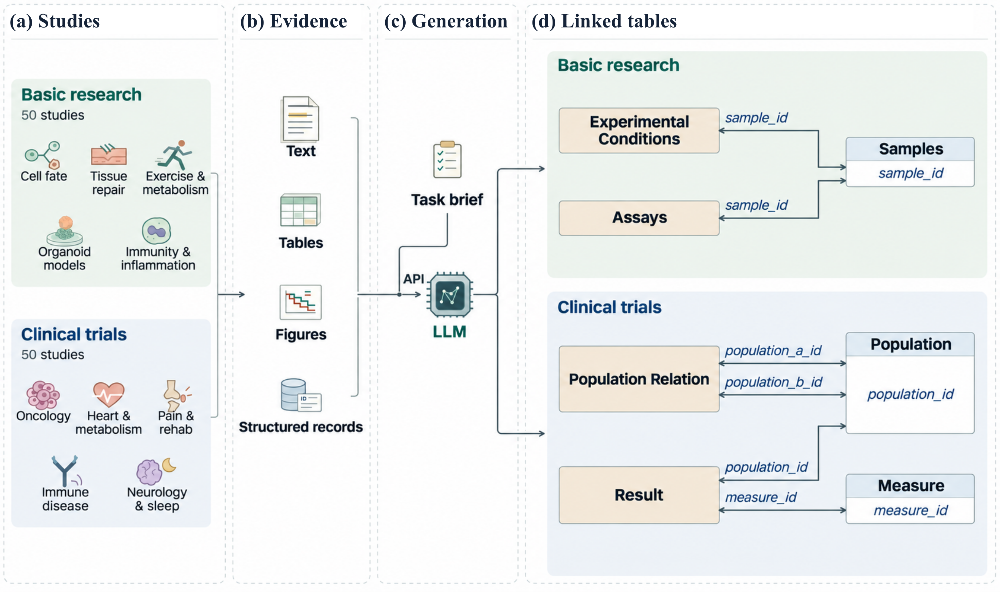
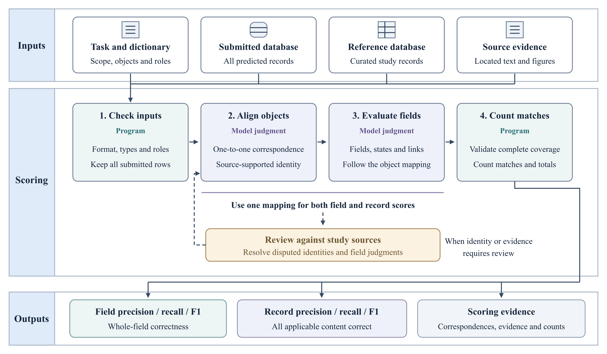

# BioTraceBench: Evaluating Experimental Fidelity in Biomedical Database Construction

BioTraceBench evaluates whether language models construct scientifically faithful, linked databases from biomedical study materials. Correct values must remain attached to the experimental objects, populations, measurements, and analysis contexts that produced them.

The benchmark contains 100 clinical and basic research tasks. **Experimental Fidelity Evaluation (EFE)** aligns submitted and reference objects once, then evaluates whole scientific fields and complete records under that shared mapping. Programs check judgment coverage and compute field and record precision, recall, and F1.



This repository provides the generation runtime, scoring interfaces, publication analyses, synthetic tests, and manuscript figures. Study materials and frozen evaluation inputs are supplied through a separate materials package.

## Installation

Use Python 3.12 or later. From a checkout:

```sh
python -m venv .venv
source .venv/bin/activate
python -m pip install -e '.[analysis]'
```

Install `.[generation]` to prepare source documents and run a configured model; install `.[test]` for the complete offline test suite. Core installation, imports, help, and the synthetic demo work without study data or API credentials.

## Quick start

Run a synthetic example with explicit scientific judgments:

```sh
python scripts/demo.py --out /tmp/biotracebench-demo
```

Recompute the paper's analyses from the separate materials package:

```sh
python scripts/reproduce_paper.py \
  --artifact-root MATERIALS_DIR --out OUTPUT_DIR --figures
```

Prepare a new submitted database for scientific review:

```sh
python scripts/score_output.py prepare \
  --artifact-root MATERIALS_DIR --case CASE_ID \
  --database SUBMISSION.json --out PLAN_DIR
```

After completing the judgment file, validate coverage and calculate the six metrics:

```sh
python scripts/score_output.py finalize \
  --artifact-root MATERIALS_DIR --plan PLAN_DIR \
  --judgment JUDGMENT.json --actor REVIEWER_NAME --out SCORE_DIR
```

Use a new output directory for each command. Scientific judgments are explicit inputs; replay recomputes the metrics and analyses from those judgments. Model generation requires a separately configured provider and an explicit execution command.

## Evaluation workflow



1. Bind the task, schema, reference, field policy, source material, and submitted output.
2. Establish one-to-one scientific object identities and judge every field under that mapping.
3. Resolve source-dependent questions and record the reviewer and evidence.
4. Validate complete coverage, apply the external eligibility decisions, and count matches.

## Documentation

- [Evaluation protocol and new-output scoring](docs/evaluation.md)
- [Paper reproduction and expected checks](docs/reproduction.md)
- [External materials interface](docs/materials.md)
- [Model generation and conversation preservation](docs/generation.md)
- [Figure index and captions](figures/README.md)
- [Code structure and verification](docs/development.md)
- [Source provenance and third-party notices](THIRD_PARTY.md)

## Repository structure

```text
src/        Generation, model clients, scoring, and publication analyses
configs/    Schemas, field roles, scoring policy, and model templates
scripts/    Demonstration, reproduction, scoring, and packaging entry points
tests/      Synthetic and mocked-provider regression tests
docs/       Scientific protocol and executable instructions
figures/    Original manuscript PNG and SVG figures
```

The repository is maintained privately while the publication code is prepared. Author-provided code and figures currently have no public reuse license; dependency licenses and source attribution are recorded separately.
